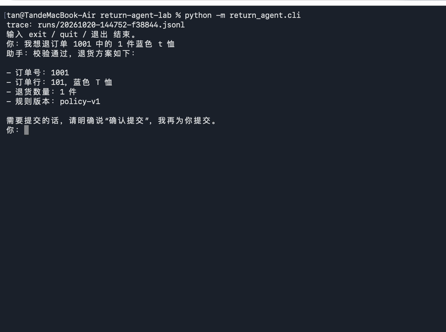
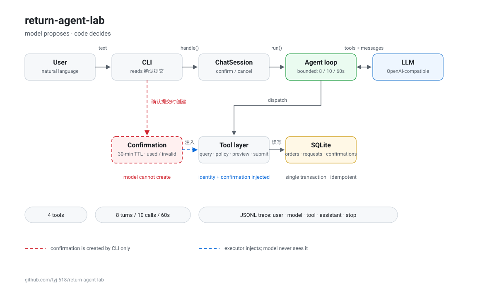

# return-agent-lab

一个**退货申请处理 Agent**：用户用自然语言提出退货，Agent 负责澄清、查询、生成方案；系统负责身份注入、规则判定、确认绑定与事务写入。

**状态**：可运行、可评测、有端到端 trace 证据。102 个测试；10 个固定案例 ×3 轮，Agent 30/30，固定流程基线 9/10。

## Demo



15 秒：预览方案 → 确认提交 → 写入申请 → 库中可见（9003）。

## 快速开始

```bash
# 1. 环境：Python 3.14
python3 --version

# 2. 安装依赖（仅 openai）
python3 -m pip install -r requirements.txt

# 3. 配置模型（OpenAI 兼容端点，默认示例为 DeepSeek）
cp .env.example .env
# 编辑 .env：OPENAI_API_KEY / OPENAI_BASE_URL / MODEL_NAME

# 4. 启动 CLI
python3 -m return_agent.cli
```

CLI 输入示例：

```text
你：我想退订单 1001 里的 1 件蓝色 T 恤
助手：校验通过，方案如下……
你：确认提交
助手：您提交的退货申请已成功创建……
```

## 测试与评测

```bash
# 单元测试（102 个，不联网）
python3 -m unittest discover -s tests -t .

# 评测：10 案例（会调用真实模型）
python3 -m eval.run_eval

# 评测：固定流程基线（不调用模型）
python3 -m eval.run_eval --baseline
```

> 必须在项目根目录执行测试。直接跑 `python3 tests/test_xxx.py` 会因 `sys.path` 找不到 `return_agent` 而失败。

## 架构



- 确认记录只由 CLI 在精确输入「确认提交」时创建；模型无权创建。
- 身份与确认由执行器注入，模型不可见、不可指定。
- 工具层的检查与写入在同一个 `BEGIN IMMEDIATE` 事务内。

## 安全边界

| 边界 | 做法 |
| --- | --- |
| 身份 | `current_user_id` 由执行器注入，模型不可见、不可指定 |
| 判定 | 能否退货由 `validation.py` + `policy.py` 决定，不靠模型 |
| 方案绑定 | `plan_hash` 为订单行快照的 SHA-256；状态变化即失效 |
| 确认 | 只有 CLI 在精确输入「确认提交」时创建；30 分钟过期 |
| 写入 | 检查与写入在同一 `BEGIN IMMEDIATE` 事务；重复提交返回 `already_exists` |
| 可回放 | 每次运行写 JSONL trace（user / model / tool / assistant / stop） |

## 评测结果（2026-10-19，DeepSeek `deepseek-chat`）

| 指标 | Agent | 固定流程基线 |
| --- | --- | --- |
| 通过率 | **30/30**（10 案 ×3 轮） | **9/10** |
| 平均 token / 案 | **3744** | 0 |
| 平均延迟 / 案 | **2573 ms** | ~0 ms |

基线唯一失败是 **C02**（无订单号、商品名近似），属结构性失败；Agent 的历史失败 **C08** 是"绕过 `preview` 自行判断数量"，已通过提示词修正并复测 3 次。

完整方法、失败分析与局限见 [`docs/evaluation.md`](docs/evaluation.md)。

## 仓库结构

```text
return_agent/   业务代码：规则、存储、工具、Agent 循环、CLI
tests/          102 个测试
eval/           10 案例评测 + 固定流程基线
docs/           需求、契约、设计、评测报告、开发日志、trace 证据
```

## 文档索引

见 [`docs/README.md`](docs/README.md)。建议顺序：

1. [`docs/requirements.md`](docs/requirements.md) — 目标与范围
2. [`docs/acceptance.md`](docs/acceptance.md) — E01–E03 验收
3. [`docs/tools.md`](docs/tools.md) — 四个工具的契约与错误码
4. [`docs/agent_flow.md`](docs/agent_flow.md) — Agent 循环与停止条件
5. [`docs/confirmation_flow.md`](docs/confirmation_flow.md) — 确认与提交流程
6. [`docs/evaluation.md`](docs/evaluation.md) — 评测方法与结果
7. [`docs/dev-log.md`](docs/dev-log.md) — 每一步怎么做、错在哪

## 开发方式与过程证据

本项目以 AI 辅助编码完成，本人负责契约、指令、审查与验收。

- 缺陷台账：[docs/defect-ledger.md](docs/defect-ledger.md)（13 条已记录问题（11 条缺陷 + 2 条设计取舍））
- 协作方法：[docs/ai-collaboration.md](docs/ai-collaboration.md)
- 里程碑指标：[docs/metrics.md](docs/metrics.md)
- 逐日记录：[docs/dev-log.md](docs/dev-log.md)

## 已知局限

- 身份使用演示常量 `U001`，没有多用户鉴权。
- 并发只测了同进程两连接，未测多进程。
- 确认 30 分钟过期只在单元测试验证。
- 会话内订单数据不刷新（`query_orders` 一次调用后被历史复用）。
- 评测样本小（每案 3 次），未做人工评估。